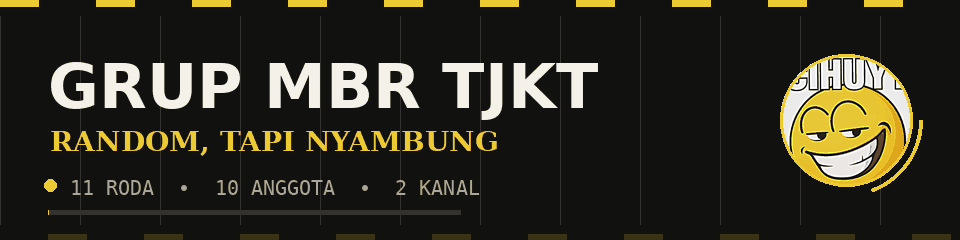
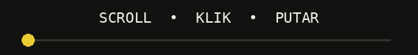
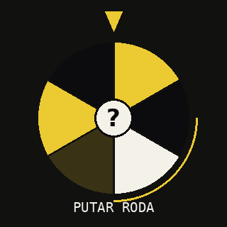

<div align="center">

# Grup mbr TJKT

[](https://ikyletwar.github.io/grup-mbr-tjkt/)
[](https://github.com/Ikyletwar/grup-mbr-tjkt)
[](https://github.com/Ikyletwar/grup-mbr-tjkt)
[](https://github.com/Ikyletwar/grup-mbr-tjkt)
[](https://github.com/Ikyletwar/grup-mbr-tjkt)

**Random, tapi nyambung.**  
Satu halaman untuk arsip chat ujian, soal dadakan, jadwal mabar, daftar anggota, dan sebelas roda random Grup mbr TJKT.



<a href="https://ikyletwar.github.io/grup-mbr-tjkt/">🌐 Buka website</a> ·
<a href="https://discord.gg/JPavy7x6p">💬 Discord</a> ·
<a href="https://chat.whatsapp.com/IfFIyJJckfm5YqHW2lecuT">📱 WhatsApp</a>

</div>

---

## Daftar Isi

- [Tentang](#tentang)
- [Fitur](#fitur)
- [Anggota Grup](#anggota-grup)
- [Kanal Komunitas](#kanal-komunitas)
- [Struktur Repository](#struktur-repository)
- [Cara Menjalankan](#cara-menjalankan)
- [GitHub Pages](#github-pages)
- [Kustomisasi](#kustomisasi)
- [Animasi dan Efek](#animasi-dan-efek)
- [Responsive](#responsive)
- [Aksesibilitas](#aksesibilitas)
- [FAQ Interaktif](#faq-interaktif)
- [About](#about)
- [Roadmap](#roadmap)
- [Changelog](#changelog)
- [Kontribusi](#kontribusi)
- [Lisensi](#lisensi)
- [Kontak](#kontak)



---

<a id="tentang"></a>

## Tentang

`grup-mbr-tjkt` adalah website satu halaman untuk grup **Grup mbr TJKT**. Isinya sengaja dirandom: percakapan ujian, soal mendadak, jadwal mabar, daftar anggota, aturan tidak resmi, dan roda yang mengambil keputusan saat grup sedang tidak sepakat.

Website ini dibuat sebagai **static site**: satu file `index.html` berisi HTML, CSS, dan JavaScript. Tidak ada framework, tidak ada bundler, tidak ada backend, tidak ada API key, dan tidak ada dependency runtime.

| Fakta | Nilai |
|---|---|
| Nama grup | Grup mbr TJKT |
| Tagline | Random, tapi nyambung |
| Arsitektur | Single-file HTML + CSS + JS |
| Build step | Tidak ada |
| Deploy | GitHub Pages, branch `main`, folder `/root` |
| Tema | Light + dark, tersimpan di `localStorage` |
| Kanal | Discord + WhatsApp |
| Anggota tercatat | 10 orang |
| Roda random | 11 roda |
| Breakpoint | `421px`, `721px`, `900px`, `981px`, `1200px` |

<details>
<summary>🎯 Lihat filosofi desainnya</summary>

Palet warna diambil dari logo grup: kuning `#ebca32`, hitam `#0c0b0d`, dan paper `#f4f1e9`. Layout memakai grid disiplin, whitespace besar, divider tipis, radius terkontrol, dan shadow yang restrained.

Animasi tidak dipakai sebagai dekorasi pasif. Scroll progress memberi konteks posisi, reveal membantu ritme baca, counter menandai data, dan roda memberi umpan balik langsung setelah keputusan diambil.

</details>

---

<a id="fitur"></a>

## Fitur

| Section | Isi | Interaksi |
|---|---|---|
| Hero | Identitas grup, logo, CTA Discord + WhatsApp | Parallax logo, orbit pulse, scroll cue |
| Tentang | Ringkasan grup dan counter | Counter animasi saat masuk viewport |
| Kanal | Discord sebagai markas utama, WhatsApp sebagai kanal kedua | Salin invite, buka tautan di tab baru |
| Arsip chat | 6 sampel percakapan khas grup | Filter kategori |
| Soal | 4 kuis ringan | Pilih jawaban, feedback, skor, restart |
| Mabar | Jadwal tidak resmi + papan skor | Tombol “Tandai hadir” dengan state |
| Anggota | 10 anggota + badge admin | Kartu hover/active, reveal bergilir |
| Roda | 1 roda utama + 10 roda mini | Putar, hasil berbeda dari putaran sebelumnya |
| Aturan | 3 aturan tidak resmi | Kartu shine |
| FAQ | 6 pertanyaan | Expand/collapse halus |
| About | Kredit pembuat: Hizkia Letwar / “Nihongo?” | Kartu kreatif + tautan GitHub |
| Tema | Light/dark | Toggle keyboard-friendly, preferensi tersimpan |
| Navigasi | Anchor ke tiap section | Active state mengikuti scroll |
| Floating CTA | Akses cepat Discord/WhatsApp | Muncul setelah scroll tertentu |



<details>
<summary>🧠 Kenapa ada dua kanal?</summary>

Discord diposisikan sebagai markas utama karena invite dan struktur server lebih cocok untuk arsip, channel, dan komunitas. WhatsApp tetap dipertahankan sebagai kanal kedua karena notifikasinya lebih dekat ke keseharian anggota.

Keduanya bukan pengganti. Keduanya sengaja muncul di hero, panel komunitas, FAQ, footer, dan floating CTA.

</details>

---

<a id="anggota-grup"></a>

## Anggota Grup

Sepuluh orang yang tercatat di website:

| No | Nama | Peran |
|---:|---|---|
| 01 | Alfan Setiawan | Admin Grup / Admin Femboy |
| 02 | Daffah Maulana | Anggota |
| 03 | Gihon G Runtuthomas | Anggota |
| 04 | Johanes Walalayo | Anggota |
| 05 | Kamarula | Anggota |
| 06 | Paul Dessa | Anggota |
| 07 | Rizky R. Rap Rap | Anggota |
| 08 | Saif Aslam Ipaenin | Anggota |
| 09 | Karel Halawane | Anggota |
| 10 | Hizkia Letwar | Anggota |

Nama ditampilkan persis di section `#anggota`. Alfan Setiawan memakai kartu admin dengan dua badge: `Admin Grup` dan `Admin Femboy`.

---

<a id="kanal-komunitas"></a>

## Kanal Komunitas

| Kanal | Fungsi | Tautan |
|---|---|---|
| Discord | Markas utama, arsip, channel, komunitas | https://discord.gg/JPavy7x6p |
| WhatsApp | Notifikasi cepat dan koordinasi harian | https://chat.whatsapp.com/IfFIyJJckfm5YqHW2lecuT |

Semua tautan eksternal memakai:

```html
target="_blank" rel="noopener noreferrer"
```

Tombol salin invite memakai atribut generik `data-copy` dan `data-channel`, sehingga Discord dan WhatsApp keduanya bisa disalin tanpa duplikasi logika.

---

<a id="struktur-repository"></a>

## Struktur Repository

```text
grup-mbr-tjkt/
├── index.html
├── assets/
│   └── logo-grup-mbr-tjkt.jpeg
├── docs/
│   └── assets/
│       ├── readme-hero.gif
│       ├── readme-wheel.gif
│       └── readme-pulse.gif
├── scripts/
│   └── generate_readme_assets.py
├── README.md
└── LICENSE
```

| File | Fungsi |
|---|---|
| `index.html` | Seluruh website: markup, token CSS, komponen, dan logika JS |
| `assets/logo-grup-mbr-tjkt.jpeg` | Identitas visual grup |
| `docs/assets/*.gif` | Aset README beranimasi |
| `scripts/generate_readme_assets.py` | Generator GIF README dengan Pillow |
| `README.md` | Dokumentasi lengkap dan interaktif |
| `LICENSE` | Lisensi MIT |

---

<a id="cara-menjalankan"></a>

## Cara Menjalankan

### Opsi 1 — Buka langsung

Buka `index.html` di browser. Tidak perlu instalasi.

### Opsi 2 — Local server

```bash
python3 -m http.server 8000 --directory "/home/nihongo/Dokumen/Default Project/grup-mbr-tjkt"
```

Lalu buka:

```text
http://localhost:8000
```

### Regenerasi aset animasi README

Butuh Pillow:

```bash
pip3 install pillow
python3 scripts/generate_readme_assets.py
```

Output yang diharapkan:

```text
readme-hero.gif: ~678 KB
readme-wheel.gif: ~134 KB
readme-pulse.gif: ~58 KB
```

---

<a id="github-pages"></a>

## GitHub Pages

Repository ini aktif di GitHub Pages dengan konfigurasi:

| Pengaturan | Nilai |
|---|---|
| Repository | `Ikyletwar/grup-mbr-tjkt` |
| Source | Deploy from a branch |
| Branch | `main` |
| Folder | `/root` |
| URL | https://ikyletwar.github.io/grup-mbr-tjkt/ |

### Aktifkan ulang lewat UI

1. Buka `Settings` → `Pages`.
2. Pilih `Deploy from a branch`.
3. Pilih branch `main`.
4. Pilih folder `/root`.
5. Simpan, lalu tunggu deploy selesai.

### Cek status lewat CLI

```bash
gh api repos/Ikyletwar/grup-mbr-tjkt/pages --jq '.status + " " + .url'
```

---

<a id="kustomisasi"></a>

## Kustomisasi

<details>
<summary>🔗 Mengganti tautan komunitas</summary>

Cari atribut `data-channel="discord"` dan `data-channel="whatsapp"` di `index.html`. Nilai tautan juga dipakai oleh tombol salin.

```html
<a class="discord-link" href="https://discord.gg/JPavy7x6p" data-channel="discord">
```

</details>

<details>
<summary>👥 Mengubah daftar anggota</summary>

Cari blok:

```html
<div class="member-grid">
```

Setiap kartu memakai struktur:

```html
<article class="member-card reveal">
  <span class="member-avatar" aria-hidden="true">AS</span>
  <div class="member-body">
    <span class="num">Anggota 01</span>
    <h3 class="member-name">Alfan Setiawan</h3>
    <div class="member-badges"><span class="member-role">Anggota</span></div>
  </div>
</article>
```

Tambahkan `class="member-card is-admin reveal"` untuk kartu admin.

</details>

<details>
<summary>🎡 Menambah roda random</summary>

Dua tempat yang perlu diubah:

1. Salin satu `<article class="mini-wheel reveal" data-wheel="...">` di section `#roda`.
2. Tambahkan entri dengan key yang sama di objek JavaScript `miniWheelData`.

```javascript
makan: [
  { label: 'NASGOR', text: 'Nasi goreng. Aman, cepat, dan jarang bikin debat panjang.' },
  { label: 'INDO', text: 'Indomie. Level berani ditentukan oleh yang paling lapar.' }
]
```

Label sebaiknya maksimal 7 karakter agar tidak overflow di dial.

</details>

<details>
<summary>🌗 Mengubah warna tema</summary>

Token warna ada di `:root` dan `:root[data-theme="dark"]`. Ubah variabel berikut untuk palet baru:

```css
--paper
--paper-2
--ink
--muted
--line
--yellow
--yellow-soft
--white
--on-accent
```

Key penyimpanan tema:

```text
mbr-tjkt-theme
```

</details>

---

<a id="animasi-dan-efek"></a>

## Animasi dan Efek

| Efek | Lokasi | Teknik | Reduced motion |
|---|---|---|---|
| Scroll progress | Header atas | `transform: scaleX()` | Tetap statis, transisi dimatikan |
| Reveal konten | Semua section | `opacity` + `translateY` via IntersectionObserver | Langsung terlihat |
| Counter | Section Tentang | `requestAnimationFrame` | Angka final langsung ditampilkan |
| Parallax logo | Hero | `translate3d()` | Dinonaktifkan |
| Orbit pulse | Hero | `opacity` | `animation: none` |
| Card shine | Counter, kartu | `::after` + transform | Transisi `.01ms` |
| FAQ expand | FAQ | `max-height` + opacity | Tanpa animasi |
| Copy feedback | Tombol salin | Perubahan teks + state | Tetap berfungsi |
| Roda mini | Section roda | `rotate()` + `scale()` | Delay spin `0` |
| Ticker | Atas kanal | CSS keyframes translate | `animation: none` |
| Floating CTA | pojok kanan bawah | opacity + translate | Transisi `.01ms` |

Prinsipnya: animasi memakai properti murah (`transform`, `opacity`), durasi pendek, easing alami, dan tidak memicu layout thrash.

```css
@media (prefers-reduced-motion: reduce) {
  *, *::before, *::after {
    transition-duration: .01ms !important;
    animation-duration: .01ms !important;
  }
}
```

---

<a id="responsive"></a>

## Responsive

Pendekatan yang dipakai adalah **mobile-first**: baseline satu kolom, lalu breakpoint menambah kompleksitas.

| Breakpoint | Perubahan utama |
|---|---|
| `< 421px` | Satu kolom, header wrap, nav scroll horizontal |
| `≥ 421px` | Row jadwal dan invite mulai rapi |
| `≥ 721px` | Grid 2 kolom untuk chat, aturan, dan anggota |
| `≥ 900px` | Header nav inline, tanpa scroll |
| `≥ 981px` | Layout desktop penuh, grid 3 kolom |
| `≥ 1200px` | Grid anggota 5 kolom |

Tidak ada aturan `@media (max-width: ...)` di file. Semua breakpoint memakai `min-width`.

Hasil verifikasi: tanpa horizontal overflow di `320`, `390`, `768`, `900`, `981`, dan `1280px`.

---

<a id="aksesibilitas"></a>

## Aksesibilitas

| Aspek | Implementasi |
|---|---|
| Semantik | `header`, `nav`, `main`, `section`, `article`, `footer` |
| Heading | Satu `h1`, `h2` per section, `h3` untuk kartu |
| Logo | `alt="Logo Grup mbr TJKT"` |
| Tombol | `type="button"` eksplisit |
| Toggle tema | `aria-pressed`, `aria-label` dinamis, keyboard `Space` |
| Live region | `aria-live="polite"` pada hasil kuis dan roda |
| Focus | `:focus-visible` outline solid 2px |
| Tautan eksternal | `aria-label` + `rel="noopener noreferrer"` |
| Kontras | Body light `17.40:1`, dark `16.74:1` |
| Kontras komponen | Dial `12.18:1`, badge admin `15.41:1`–`19.32:1` |
| Reduced motion | Seluruh animasi dan transisi dinonaktifkan/dipendek |

---

<a id="faq-interaktif"></a>

## FAQ Interaktif

Klik atau tap panel di bawah untuk membuka jawabannya.

<details>
<summary>Apakah website ini butuh backend?</summary>

Tidak. Semua konten, interaksi, dan preferensi ada di browser. Tema disimpan di `localStorage`, sedangkan state kuis, filter, dan roda hanya berada di memori halaman.

</details>

<details>
<summary>Kenapa hasil roda tidak langsung mengulang pilihan sebelumnya?</summary>

Setiap roda menyimpan `lastIndex`. Jika hasil acak sama dengan hasil sebelumnya, kode memilih indeks berikutnya:

```javascript
if (next === lastIndex) next = (next + 1) % choices.length;
```

Ini mencegah kesan roda “rusak” saat dua putaran berturut-turut sama.

</details>

<details>
<summary>Bagaimana dark mode tersimpan?</summary>

Saat toggle ditekan, nilai `dark` atau `light` ditulis ke `localStorage` dengan key `mbr-tjkt-theme`. Inisialisasi dilakukan di `<head>` sebelum body dirender, sehingga tidak ada flash tema.

</details>

<details>
<summary>Bisa dipakai offline?</summary>

Bisa. Buka `index.html` langsung dari folder. Semua CSS, JavaScript, dan logo bersifat lokal. Tautan Discord/WhatsApp tetap membutuhkan internet.

</details>

<details>
<summary>GIF README digenerate dari apa?</summary>

Dari `scripts/generate_readme_assets.py` memakai Pillow. Asetnya adalah GIF animasi, bukan JavaScript, karena GitHub README mem-filter script dan sebagian CSS inline.

</details>

<details>
<summary>Apakah daftar anggota bisa diubah?</summary>

Bisa. Edit blok `.member-grid` di `index.html`. Jika jumlah anggota berubah, perbarui juga counter `joinCount` agar tetap konsisten.

</details>

---

<a id="about"></a>

## About

Website ini dibuat oleh **Hizkia Letwar**, yang lebih dikenal di grup sebagai **“Nihongo?”**.

<div align="center">

<a href="https://github.com/ikyletwar">🐙 github.com/ikyletwar</a>

</div>

Menu `About` di website menampilkan kredit pembuat, alias “Nihongo?”, dan tautan GitHub di atas. Kartu kredit memakai palet kuning grup dengan efek watermark `HL` dan reveal saat section masuk viewport.

---

<a id="roadmap"></a>

## Roadmap

| Status | Rencana |
|---|---|
| Selesai | Identitas visual, hero, kanal, arsip chat, kuis, jadwal |
| Selesai | 10 anggota + badge admin |
| Selesai | 11 roda random |
| Selesai | Dark mode tersimpan |
| Selesai | Mobile-first responsive |
| Selesai | GitHub Pages aktif |
| Rencana | Mode “turnamen mabar” dengan bracket |
| Rencana | Ekspor hasil undian roda ke teks |
| Rencana | Arsip chat versi JSON |
| Rencana | Pencarian FAQ |
| Rencana | Animasi transisi antar-section yang lebih kaya |

---

<a id="changelog"></a>

## Changelog

### 1.1.0 — 2026-11-26

- Menu `About` ditambahkan ke navigasi dan footer.
- Section kredit pembuat: Hizkia Letwar / “Nihongo?”.
- Tautan GitHub `github.com/ikyletwar` ditambahkan dengan state hover/focus yang konsisten.

### 1.0.0 — 2026-11-26

- Website awal: hero, arsip chat, kuis, jadwal, aturan, FAQ.
- Kanal Discord dan WhatsApp ditambahkan di seluruh CTA.
- Dark mode dengan preferensi tersimpan.
- Layout mobile-first dengan breakpoint `421/721/900/981/1200`.
- 10 roda random tambahan.
- 10 anggota dengan badge admin.
- README interaktif beranimasi.
- Deploy ke GitHub Pages.

---

<a id="kontribusi"></a>

## Kontribusi

1. Fork repository ini.
2. Buat branch baru:

   ```bash
   git checkout -b fitur-baru
   ```

3. Ubah `index.html` atau aset yang relevan.
4. Jalankan lokal dan cek di mobile + desktop.
5. Commit dengan pesan jelas:

   ```bash
   git commit -m "Tambah kategori roda baru"
   ```

6. Push dan buat pull request.

Pedoman singkat:

- Pertahankan gaya visual yang sudah ada.
- Gunakan token CSS, bukan warna hardcode baru tanpa alasan.
- Animasi harus tetap hormati `prefers-reduced-motion`.
- Setiap elemen interaktif perlu state hover, focus, active, dan disabled.

---

<a id="lisensi"></a>

## Lisensi

Dirilis di bawah lisensi MIT. Lihat file [LICENSE](LICENSE).

---

<a id="kontak"></a>

## Kontak

<div align="center">

<a href="https://discord.gg/JPavy7x6p">💬 Gabung Discord</a> ·
<a href="https://chat.whatsapp.com/IfFIyJJckfm5YqHW2lecuT">📱 Gabung WhatsApp</a> ·
<a href="https://github.com/Ikyletwar/grup-mbr-tjkt">⭐ Star repository</a>

**Random, tapi nyambung.**

</div>
